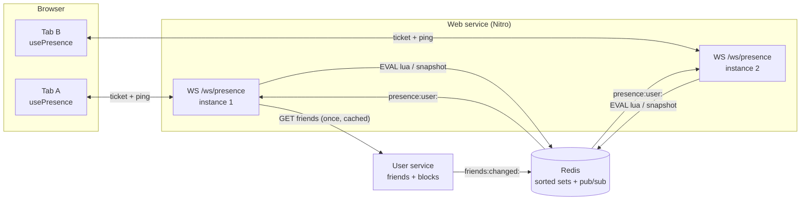
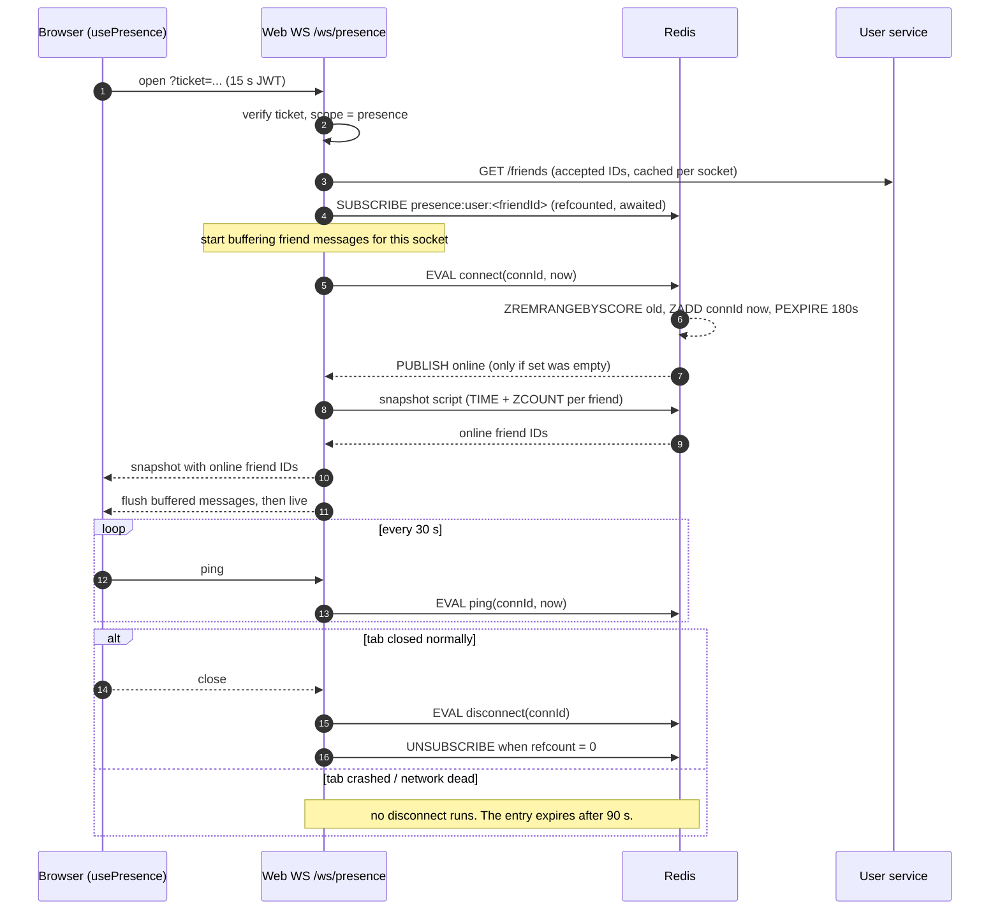
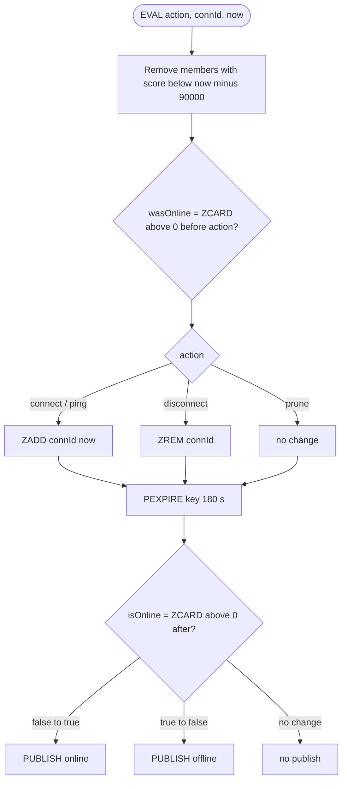
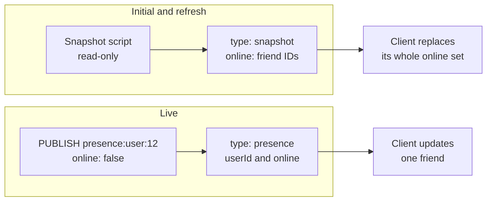

# Online presence diagrams

## 1. Architecture



Redis holds the state. Each web instance subscribes to its sockets' friends' channels. The user service only publishes `friends:changed`.

## 2. Socket lifecycle



## 3. The atomic Lua transition



The publish happens only on an edge. `prune` on an already-empty key does nothing, which avoids repeated `offline` messages.

## 4. What a crashed tab looks like over time

```text
time   0s        30s        60s      (crash)    120s       150s     180s
tab    connect   ping       ping       - - - -
score                                  60 (last ping)
friends view  online ---------------------------------------- online --> offline
                                                     ^ expired at 150 s
                                             prune tick (every 30 s) publishes offline
                                                                              between 150 and 180 s
```

A tab that closes normally goes offline at once through `disconnect`. A crashed tab goes offline after 90 s, plus at most one prune tick.

## 5. Snapshot vs live updates



The snapshot replaces the set, which corrects stale state. Live messages change one friend at a time. The buffer in step 2 of the lifecycle keeps the snapshot from overwriting a newer live message.
